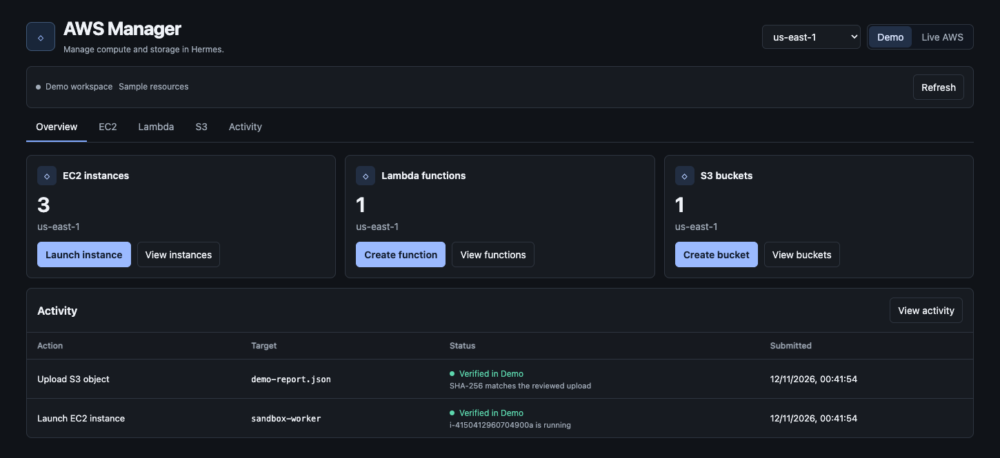

# AWS Manager for Hermes

Provision and manage EC2, Lambda, and S3 from the Hermes Desktop sidebar. Review each action in the context of its account and region, then verify supported results in Activity.

## Try Demo

Install the plugin from source with Hermes 0.22.7 or later.

```sh
hermes plugins install ParichayMago/hermes-aws-manager --yes-deps --enable
```

Open **AWS Manager** in Hermes Desktop. The dashboard opens in **Demo**, which uses sample resources without AWS credentials.

1. Open **EC2 → Launch instance**. Enter a name, choose `app-private-a` and `app-private`, then review and launch the instance.
2. Open **Activity → Verify** on the launch receipt. The row changes from **Submitted** to **Verified in Demo**.
3. Try **Lambda → process-event → Test invoke**, or **S3 → hermes-demo-artifacts** to upload and download a file. Demo Lambda echoes the event. Live Lambda executes the deployed Python.



## What you can do

| Service | Operations |
| --- | --- |
| EC2 | Launch an Amazon Linux 2023 instance, start, stop, reboot, rename, resize a stopped instance, and terminate. Select networking, an encrypted root disk, optional public IPv4, an SSH key pair, or an instance profile. Create a default VPC or security group and import a public key. |
| Lambda | Create a Python function or a dedicated logging role, deploy source, change memory and timeout, invoke with a JSON event, inspect output and CloudWatch Logs, create or remove an IAM-authenticated function URL, and delete the function. |
| S3 | Create a general purpose bucket, connect an existing bucket in the account, filter objects by prefix, upload and download objects up to 4 MiB, delete the current object, and delete an empty bucket. |
| Activity | Review the target and region before applying each change. Verify EC2 launches by checking that the instance is running and verify S3 uploads by comparing SHA-256 digests. Live Lambda invocations record the AWS request ID. |

The **Demo** workspace starts with sample resources and supports the same controls without AWS. Its state is separate from Live AWS and stays in the current Hermes profile. Demo invocations echo the sample event and do not execute the supplied Python.

## Live AWS

1. Enable the plugin in Hermes and open **AWS Manager → Live AWS → AWS credentials**. Add credentials for the AWS IAM identity that should operate the workspace. Include the session token for temporary credentials.
2. Choose a region and refresh. The account shown comes from AWS STS.
3. Choose an operation and review the exact settings before applying. For destructive actions, the dashboard asks you to type the resource identifier.

AWS permissions determine which actions are available. Use permissions scoped to the resources and actions you need. Inventory uses EC2 describe calls, Lambda function reads, and S3 bucket and object reads. EC2 launches resolve the regional Amazon Linux AMI through Systems Manager. AWS also requires `iam:PassRole` when assigning an instance profile or Lambda role. Creating a Lambda execution role requires IAM role and inline-policy write permissions. CloudWatch Logs access is needed to browse Lambda logs. Current AWS rates apply to live resources and requests.

In **Activity**, select **Verify** on an EC2 launch or S3 upload. Verification reads the exact instance or object and records the observation in the receipt. EC2 verification checks for the `running` state. S3 verification compares the current object with the SHA-256 digest of the reviewed upload. Downloads also show a match when the object has a recorded upload in the workspace.

The dashboard covers EC2 instances, Python Lambda functions and general purpose S3 buckets in the regions offered by the selector. It uses existing VPC resources or can create the region's default VPC. Function URLs created here require IAM authorization. Emptying versioned buckets and configuring network or IAM policies beyond these presets are separate AWS operations.

## Data and permissions

In Live AWS, the plugin calls AWS STS, EC2, Systems Manager, Lambda, CloudWatch Logs, S3, and IAM through the AWS SDK. AWS credentials come from Hermes' masked plugin settings and stay in Hermes' credential store. The workspace database stores reviewed settings, payload hashes, action receipts, and connected bucket names under Hermes' profile-scoped plugin data. Lambda source, live object bodies, and invocation output are transferred as needed and excluded from action history. Demo object bodies are stored locally. All AWS actions run in response to dashboard interactions. The plugin has no telemetry, shell commands, or background provisioning.
